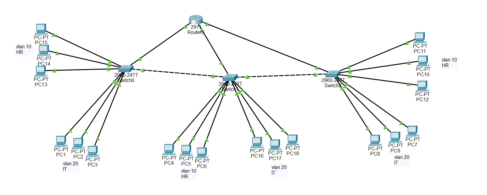

# Inter-VLAN Routing (Router-on-a-Stick) with Dynamic DHCP Addressing

## Project Overview
This project demonstrates **inter-VLAN routing** using the **Router-on-a-Stick (ROAS)** design across a three-switch topology built in Cisco Packet Tracer. The central router acts as both the Layer 3 gateway for each VLAN and a **Cisco IOS DHCP server**, automatically assigning IP addresses, subnet masks, gateways and DNS to all hosts.

## Topology



* **Devices:** 1 router, 3 Layer 2 switches (S1, S2, S3), 18 end hosts (6 per switch)
* **Segmentation:** **VLAN 10 (HR)** and **VLAN 20 (IT)**
* **Trunking:** IEEE 802.1Q on all switch-to-switch links and on the router uplink (Router `g0/0` to S1 `Fa0/24`)
* **IP allocation:** Dynamic, from DHCP pools on the router

### IP Addressing

| VLAN | Subnet | Department | Router Subinterface | Default Gateway | DHCP Range |
| :--- | :--- | :--- | :--- | :--- | :--- |
| **VLAN 10** | 192.168.10.0/24 | HR | Gig0/0.10 | 192.168.10.1 | 192.168.10.2 - .254 |
| **VLAN 20** | 192.168.20.0/24 | IT | Gig0/0.20 | 192.168.20.1 | 192.168.20.2 - .254 |

The gateway address (`.1`) of each subnet is excluded from the pools so it is never handed to a host.

### Switch Port Map

| Switch | Fa0/1 - 3 | Fa0/4 - 6 | Trunk Links |
| :--- | :--- | :--- | :--- |
| **S1** | VLAN 10 (HR) | VLAN 20 (IT) | Fa0/24 to Router g0/0 · Gig0/1 to S2 Gig0/1 |
| **S2** | VLAN 10 (HR) | VLAN 20 (IT) | Gig0/1 to S1 · Gig0/2 to S3 Gig0/2 |
| **S3** | VLAN 20 (IT) | VLAN 10 (HR) | Gig0/2 to S2 |

> **Note:** S3 is intentionally mirrored. Its Fa0/1-3 hosts are in VLAN 20 and its Fa0/4-6 hosts are in VLAN 10, so the same VLAN is reachable from different ports on different switches.
>
> S2 and S3 also have `Fa0/24` uplinks cabled to router ports `g0/1` and `g0/2`. Those router ports have no subinterfaces, so all inter-VLAN traffic uses the single `g0/0` trunk.

---

## Configuration Highlights
Full device configurations are in the [`configs/`](configs/) folder.

### 1. VLANs and Access Ports (S1 shown)
```cisco
vlan 10
 name HR
vlan 20
 name IT

interface range FastEthernet0/1 - 3
 switchport mode access
 switchport access vlan 10

interface range FastEthernet0/4 - 6
 switchport mode access
 switchport access vlan 20
```

### 2. Trunk Links
```cisco
! Router uplink and inter-switch links (S1 shown)
interface FastEthernet0/24
 switchport mode trunk

interface GigabitEthernet0/1
 switchport mode trunk
```
Trunks use the default allowed VLAN list and native VLAN 1. They can be restricted to the used VLANs with `switchport trunk allowed vlan 10,20`.

### 3. Router Subinterfaces (802.1Q Encapsulation)
```cisco
interface GigabitEthernet0/0
 no ip address
 no shutdown

interface GigabitEthernet0/0.10
 encapsulation dot1Q 10
 ip address 192.168.10.1 255.255.255.0

interface GigabitEthernet0/0.20
 encapsulation dot1Q 20
 ip address 192.168.20.1 255.255.255.0
```

### 4. Cisco IOS DHCP Server
```cisco
ip dhcp excluded-address 192.168.10.1
ip dhcp excluded-address 192.168.20.1

ip dhcp pool VLAN10_POOL
 network 192.168.10.0 255.255.255.0
 default-router 192.168.10.1
 dns-server 8.8.8.8

ip dhcp pool VLAN20_POOL
 network 192.168.20.0 255.255.255.0
 default-router 192.168.20.1
 dns-server 8.8.8.8
```

---

## Verification & Test Results

### Configuration checks

| Check | Command | Result |
| :--- | :--- | :--- |
| VLANs and port membership | `show vlan brief` |  |
| Trunk status | `show interfaces trunk` |  |
| DHCP leases | `show ip dhcp binding` |  |
| Routing table | `show ip route` |  |

All 18 hosts received a lease (9 in each VLAN), confirming that DHCP requests reach the router across all three switches. The routing table shows both subnets as directly connected through the subinterfaces.

### Connectivity tests

| Test | Proves | Evidence |
| :--- | :--- | :--- |
| **Same VLAN, across switches** (e.g. S1 host to S2 host) | VLAN propagation over the 802.1Q trunks |  |
| **Different VLAN, same switch** (HR to IT on S1) | Router-on-a-stick inter-VLAN routing |  |
| **Different VLAN, across switches** | Routing and trunking together |  |
| **`tracert` to a host in the other VLAN** | Traffic passes through the router gateway |  |

**Reading the results**
* A cross-VLAN reply shows `TTL=127`: the host starts at 128 and the router decrements it once. Same-VLAN replies show `TTL=128` because no router is involved.
* The first ping in Packet Tracer often shows `Request timed out` while ARP resolves. This is normal, and later replies succeed.
* `tracert` for a cross-VLAN destination lists the gateway (`192.168.10.1` or `192.168.20.1`) as the first hop.

---

## Design Notes
* Router-on-a-stick sends all inter-VLAN traffic over one physical link, which can become a bottleneck. It suits small and medium networks, while larger designs typically use Layer 3 switches (SVIs).
* Using DHCP pools on the router removes manual addressing and keeps gateways consistent for every host.

## Repository Structure
```
.
├── README.md
├── router-on-a-stick_project.pkt
├── topology/topology.png
├── configs/
│   ├── router.txt
│   ├── S1.txt
│   ├── S2.txt
│   └── S3.txt
└── screenshots/
```
Open the `.pkt` file with Cisco Packet Tracer to explore the lab.

## Skills & Technologies Demonstrated
* **IP infrastructure services:** Cisco IOS DHCP server, address exclusions, DNS option
* **Routing:** Router-on-a-Stick, Layer 3 subinterfaces, 802.1Q encapsulation
* **Switching:** VLAN creation, access and trunk ports, multi-switch VLAN propagation
* **Troubleshooting:** `show` commands, `ping`, `tracert`, DHCP binding analysis
* **Tools:** Cisco Packet Tracer
